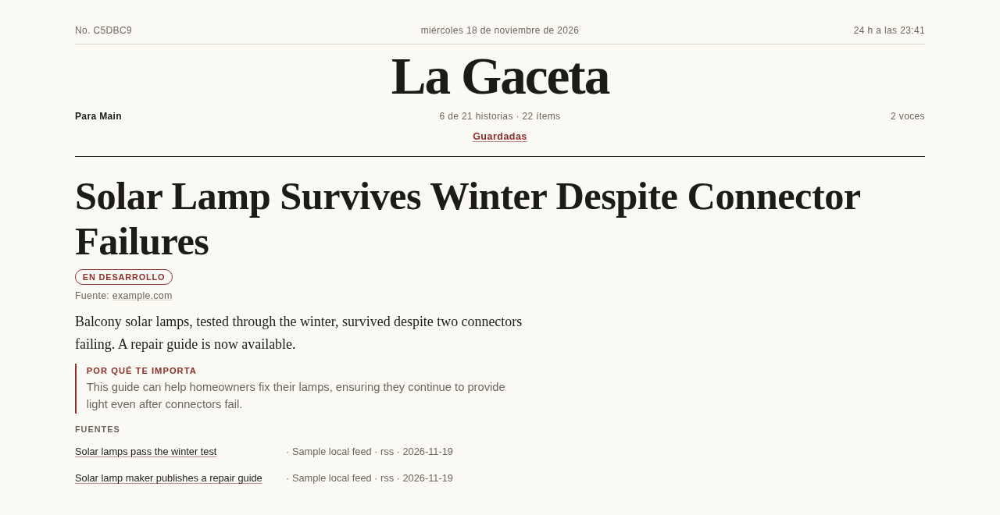

# gaceta

**A personal newspaper, edited for one reader.** Stories, not articles. Sources on every claim.

gaceta reads the feeds you already follow (blogs, news, YouTube channels, Nostr) and turns them into
a daily paper. Related items from different outlets become one **story**. That story is written up
with its sources, keeps its history, and tells you what changed since you last saw it. Your reactions
steer what comes next.

It runs on your machine, with your models (local Ollama or any OpenAI-compatible API) and your data.
Everything is a CLI command, so a cron job or your own AI agent can run the whole paper.



```
feeds ──▶ ingest ──▶ embed ──▶ cluster ──▶ write ──▶ edition ──▶ render / serve
          (RSS, YouTube,       (stories, not   (LLM write-ups   (immutable    (static HTML,
           Nostr, plugins)      articles)       with sources)    snapshot)     phone-friendly)
```

## Why

- **Stories, not articles.** Twelve outlets covering one event make one card, with the coverage
  listed underneath, not twelve near-duplicate links.
- **Evidence first.** Write-ups are built from the source text (YouTube only when a transcript
  exists, never from clickbait titles), and every card links to its sources.
- **It remembers.** Stories evolve across days. When a story you already read changes, the card
  says what's new since you saw it.
- **One verdict per story.** *More like this*, *less like this* or *seen*. Each tap trains a taste
  model, and an ⓘ button explains why any story ranked where it did.
- **Private by structure.** Every item and story carries a privacy label (`private`, `household`,
  `public`). Renderers take a maximum level, so a public build physically can't emit private rows,
  and external models only ever see public source text unless you allow it.
- **Cheap to run.** Clustering is local embeddings. The LLM only rewrites stories that changed, and
  `write` takes hard budgets: `--max-llm-calls` for write-ups and `--max-change-calls` for the
  "what changed since you saw it" notes.
- **Several readers, one install.** Readers share fetched content; editions, reactions and taste
  stay per reader.

## Install

Requires Python ≥ 3.12 and [uv](https://docs.astral.sh/uv/).

```bash
uv tool install git+https://github.com/gaceta-news/gaceta-cli
# or, from a clone:
git clone https://github.com/gaceta-news/gaceta-cli && cd gaceta-cli && uv sync
```

## Quickstart (offline, two minutes)

`gaceta init` writes an example reader, a sample feed and deterministic fake models, so the whole
pipeline runs with no network and no keys:

```bash
export GACETA_DATA=~/gaceta-data       # db, configs and site live here (default ./data)
gaceta init                            # → readers/main/reader.toml + sample-feed.xml
gaceta ingest rss --reader main
gaceta embed --reader main
gaceta cluster --reader main
gaceta write --reader main --days 14
gaceta edition --reader main
gaceta render --reader main            # → $GACETA_DATA/site/main/index.html
gaceta serve                           # optional: localhost server with working reactions
```

Fake models prove the plumbing but write nothing useful. For a real paper, see below.

## A real paper, fully local (no API keys)

With [Ollama](https://ollama.com) running, pull an embedding model and a chat model:

```bash
ollama pull bge-m3
ollama pull qwen2.5:3b
```

Start from a clean data directory so the demo stories don't mix in
(`export GACETA_DATA=~/my-paper && gaceta init`). Then, in `readers/main/reader.toml`, **replace** the
sample `[[sources.rss.feeds]]` block and the `[embed]` / `[llm.editor]` tables with:

```toml
[[sources.rss.feeds]]
id = "bbc-tech"
name = "BBC Technology"
url = "https://feeds.bbci.co.uk/news/technology/rss.xml"

[embed]
provider = "ollama"
model = "bge-m3"
base_url = "http://localhost:11434"

[llm.editor]
provider = "openai"                  # any OpenAI-compatible endpoint
model = "qwen2.5:3b"            # bigger = better write-ups
base_url = "http://localhost:11434/v1"
api_key_env = ""                     # empty = no auth (local servers)
timeout = 300                        # seconds per call; small models on CPU are slow
```

Using a hosted model instead: set `base_url`/`model` to your provider and
`api_key_env = "OPENAI_API_KEY"` (or whatever env var holds the key). The same goes for `[embed]`
with `provider = "openai"`. Keys are only read from the environment, never from config files.

Use an instruct model that answers directly. Reasoning models ("thinking" variants) tend to spend
the token budget before emitting the JSON card. A 3B model on CPU writes a card in about ten
seconds; small models also get facts wrong more often, so prefer the biggest one you can run.

Then run the same commands as the quickstart and put them in cron or a systemd timer, with
`gaceta edition --reader main --force` so reruns on the same day replace the snapshot. A run only
rewrites stories that changed.

## Configuration

One TOML file per reader at `$GACETA_DATA/readers/<id>/reader.toml`. Personal settings live there,
never in code.

| Section | What |
|---|---|
| `id`, `name`, `langs` | reader identity; `langs = "es,en"`: write-ups in the first language |
| `ui_lang`, `masthead` | interface language (default: first of `langs`) and the paper's name |
| `[[sources.rss.feeds]]` | RSS/Atom/YouTube feeds (`url`, or `file` for a local feed; `kind`) |
| `[sources.rss.transcripts]` | how YouTube transcripts are fetched; videos without one are skipped |
| `[sources.nostr_wot]` | web-of-trust-ranked Nostr notes (readiness-gated) |
| `[embed]`, `[llm.editor]` | providers: `ollama`, `openai` (compatible), or `fake` |
| `[cluster]` | `threshold` (cosine "same story") and `window_days` |
| `[[sections]]` | named sections matched by source kind, source-id prefix or keywords |
| `[privacy]` | canary terms pinned to `private` / `household` |
| `[conditions.<name>]` | optional boxes of moving numbers (weather, a level), see below |

## Languages

The whole paper follows the reader: interface, dates, ranking explanations and write-ups.
Interface languages shipped: English, Spanish, Portuguese, French, German and Italian
(`ui_lang`, or the first of `langs`; anything else falls back to English). Write-ups can be in any
language your model writes: the stories are told in `langs`' first language whatever language the
sources are in. With a multilingual embedding model (e.g. `bge-m3`), an English and a Spanish
report of the same event cluster into one story.

If a model answers in the wrong language anyway (small local models like to echo the source),
gaceta notices and asks once more, inside the same `--max-llm-calls` budget.

Adding an interface language is one file: copy `src/gaceta/locales/en.json` to `<code>.json`,
translate the values and keep the keys and `{placeholders}`. The tests check every catalog.

## Source adapters

Built in: `rss` (RSS 2.0, RSS 1.0, Atom, YouTube channel feeds), `nostr_wot`, and `sqlite`, an
example adapter for collector-style databases.

Anything else is a plugin. Write a class with a `name` and an `items(since=None)` method that yields
`gaceta.sources.base.RawItem`, then register it from your own package:

```toml
# your package's pyproject.toml
[project.entry-points."gaceta.sources"]
mysource = "my_package.sources:MyAdapter"   # constructed with the reader's [sources.mysource] table
```

Now `gaceta ingest mysource --reader main` works, and `gaceta ingest all` picks it up whenever the
reader configures `[sources.mysource]`. Adapters must be read-only against their upstream.

### Condiciones (boxes of moving numbers)

A paper can carry a few small boxes, like the weather box of a printed daily: values captured when
the edition is built, printed after the portada and stamped "a las HH:MM, no en vivo" with their
source. A provider is a class whose `box(now)` returns `{"title", "lead", "facts": [[label, value]],
"source", "observed_at"}` (plain text; everything is escaped):

```toml
# your package's pyproject.toml
[project.entry-points."gaceta.conditions"]
weather = "my_package.weather:WeatherBox"

# the reader's reader.toml
[conditions.weather]
privacy = "household"   # default "private"; boxes above the edition's level are never collected
```

A provider that fails or returns nothing is skipped; a number never blocks the paper.

## Commands

| Command | Does |
|---|---|
| `init` | create the data dir, db and an example reader |
| `ingest <adapter\|all>` | pull new items |
| `embed`, `cluster` | embed items locally and group them into stories |
| `write` | LLM write-ups for stories that changed (`--max-llm-calls`, `--max-change-calls` cap spend) |
| `media` | cache thumbnails for recent stories |
| `edition`, `render` | build an immutable edition snapshot and render it to HTML |
| `serve` | localhost server with reactions (put a reverse proxy or a tailnet in front) |
| `print` | one-file HTML/PDF edition, for readers without a device |
| `feedback` | export the owner's verdicts for an upstream collector |
| `stats`, `eval` | counts and clustering evals |

Run `gaceta <command> --help` for options.

## Status

Early (v0.2) and used every day by its authors. Known gaps:

- Small local models also overstate claims now and then. Every card links its sources: check strong
  claims there, or use a bigger model.
- Corrections (flagging when a story contradicts what it said before) are designed but not built.
- An agent interface (a skill and an MCP server, so your agent can judge relevance with its own
  memory) is on the roadmap.

## Development

```bash
uv sync
uv run --with pytest pytest -q        # or: make check
```

Tests use synthetic fixtures and fake models only, with no network.

## License

[AGPL-3.0](LICENSE). If you run a modified gaceta as a service, you share your changes.
